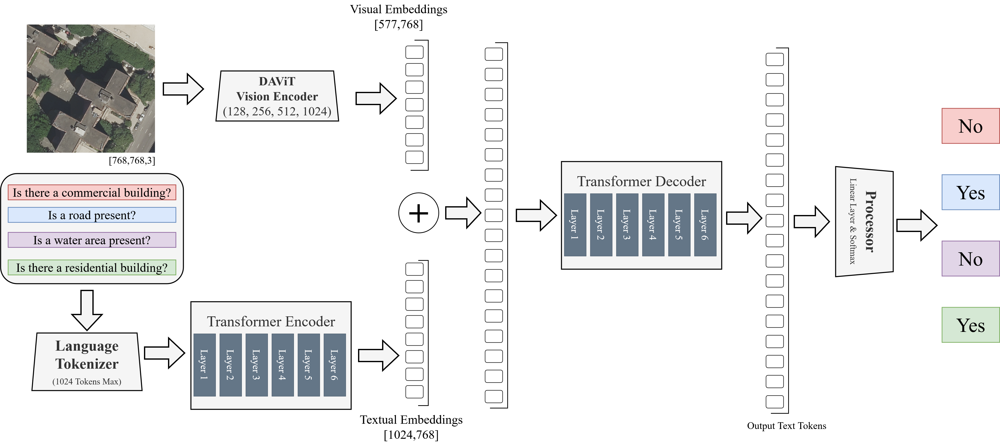
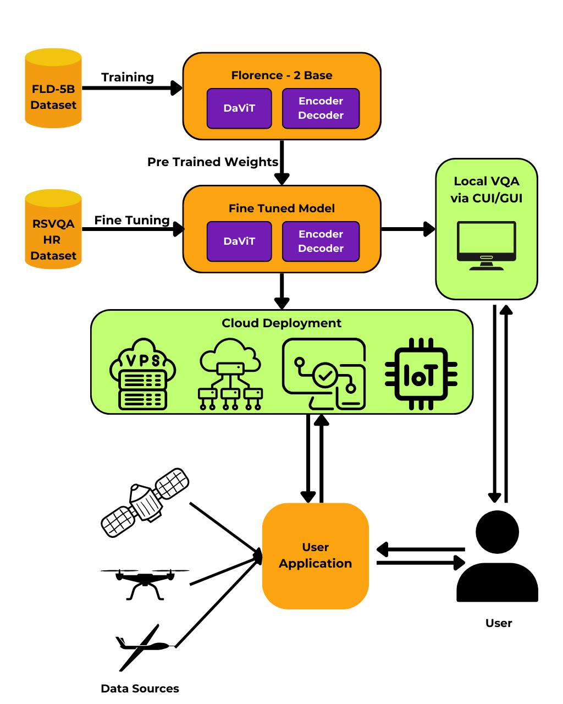
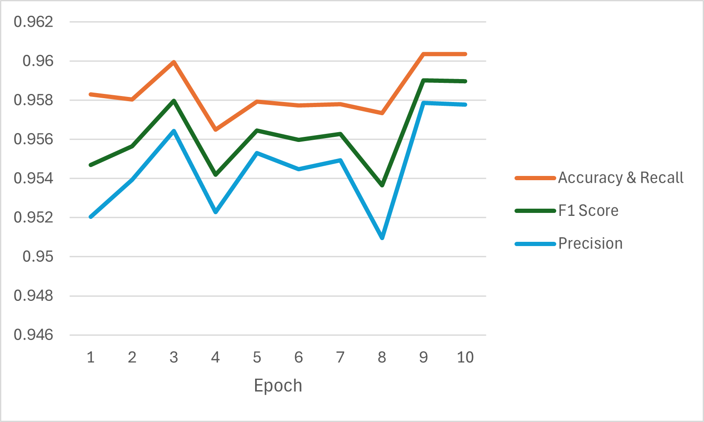
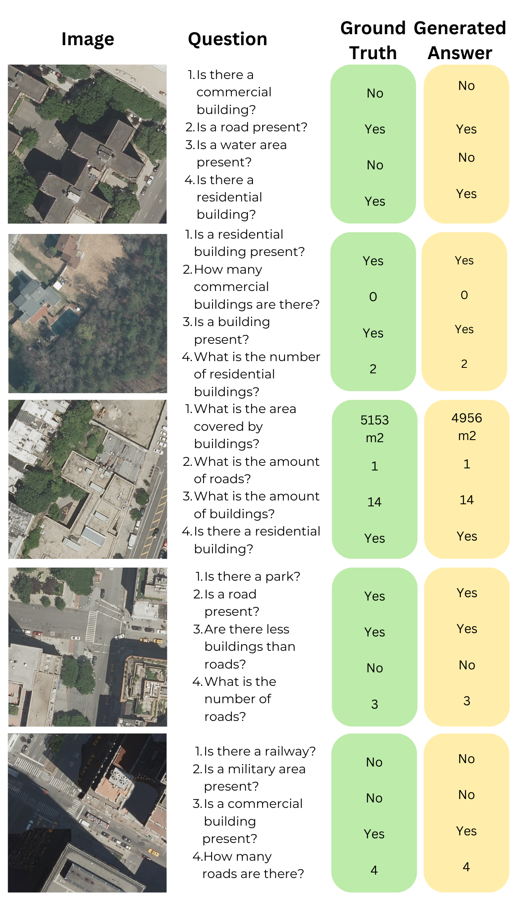

# Image-Text to Text based Multimodal AI using FLORENCE-2 for Remote Sensing Application

**Published at IEEE ICETM 2025** — [View on IEEE Xplore](https://ieeexplore.ieee.org/abstract/document/11051900)

This repository contains the code, training notebooks, and demo application for the paper:

> *Image-Text to Text based Multimodal AI using FLORENCE-2 for Remote Sensing Application*

---

## Overview

Remote Sensing Visual Question Answering (RSVQA) is the task of answering natural language questions about satellite or aerial imagery. While large vision-language models like Microsoft's **Florence-2** perform well on general multimodal tasks, they fall short when directly applied to remote sensing imagery due to domain-specific challenges — diverse sensor types, spatial scale variations, and specialized query types (e.g., area classification, object counting, presence detection).

This work fine-tunes Florence-2 on the **RSVQA-HR (High Resolution)** dataset and benchmarks it against prior approaches including ViLBERT and LXMERT.

---

## Architecture

The fine-tuned pipeline adapts Florence-2's generative VQA head using a custom `<RSVQA>` task token, enabling the model to answer remote sensing questions in a generative manner.





---

## Dataset

**RSVQA-HR (High Resolution)**
- 10659 high-resolution remote sensing images
- 955664 question–answer pairs for all images
- Question types: presence, count, comparison, rural/urban classification

Download the dataset from the [official RSVQA repository](https://zenodo.org/records/6344367).

Place it under `data/` with the following structure:
```
data/
├── Images/           # .tif image files
├── all_questions_variated.json
└── all_answers.json
```

---

## Training

The main fine-tuning script is [`training/finetune.py`](training/finetune.py).

```bash
pip install torch transformers datasets scikit-learn tqdm pandas pillow
python training/finetune.py
```

**Key hyperparameters** (set in `finetune.py`):
| Parameter | Value |
|---|---|
| Base model | `microsoft/Florence-2-base-ft` |
| Epochs | 15 |
| Batch size | 9 |
| Learning rate | 1e-6 |
| Optimizer | AdamW (linear LR schedule) |
| Vision encoder | Frozen during training |

Training notebooks (used during early exploration on Kaggle) are in [`training/notebooks/`](training/notebooks/).

Custom model architecture files used during training are in [`training/hf_model_code/`](training/hf_model_code/).

---

## Results

The fine-tuned Florence-2 outperforms prior methods on RSVQA-HR, particularly for descriptive and locational question types.





---

## Demo Application

A local client–server demo is provided in [`app/`](app/). It exposes the fine-tuned model as a Flask API and a Gradio UI.

### Setup

1. Place the fine-tuned model weights in `app/model/` (same structure as a HuggingFace `save_pretrained` output).
2. Install dependencies:
   ```bash
   pip install flask transformers torch pillow gradio requests
   ```

### Running

Start the inference server:
```bash
python app/server.py
```

In a separate terminal, launch the Gradio UI:
```bash
python app/client.py
```

Then open the Gradio link in your browser, upload a satellite image, and ask a question.

Sample images for testing are in [`app/Sample_Images/`](app/Sample_Images/).

---

## Repository Structure

```
├── training/
│   ├── finetune.py            # Main fine-tuning script
│   ├── notebooks/             # Exploratory Kaggle notebooks
│   └── hf_model_code/         # Custom Florence-2 model/processor files
├── app/
│   ├── server.py              # Flask inference server
│   ├── client.py              # Gradio UI client
│   ├── run.py                 # Standalone inference script
│   └── Sample_Images/         # Test satellite images
├── assets/                    # Figures and diagrams
├── papers/                    # Reference papers
├── ICETM_305.pdf              # Published paper
└── README.md
```

---

## Citation

If you use this work, please cite:

```
@INPROCEEDINGS{11051900,
  author={Jindal, Kunal and Saxena, Aditi and Aggarwal, Garima and Rajput, Ayush Singh and Dutta, Malay Kishore},
  booktitle={2025 International Conference on Engineering, Technology & Management (ICETM)}, 
  title={Image-Text to Text based Multimodal AI using FLORENCE-2 for Remote Sensing Application}, 
  year={2025},
  volume={},
  number={},
  pages={1-6},
  keywords={Visualization;Satellites;Computational modeling;Urban planning;Transformers;Question answering (information retrieval);Satellite images;Geospatial analysis;Artificial intelligence;Remote sensing;Visual Question Answering (VQA);Remote Sensing;Deep Learning;Multi-Modal Vision-Language Models;Satellite Image Interpretation;FLORENCE-2 Model},
  doi={10.1109/ICETM63734.2025.11051900}}

```

---

## References

- [Florence-2: Advancing a Unified Representation for a Variety of Vision Tasks](https://arxiv.org/abs/2311.06242) — Microsoft Research
- [RSVQA: Visual Question Answering for Remote Sensing Data](https://arxiv.org/abs/2003.07333) — Lobry et al.
